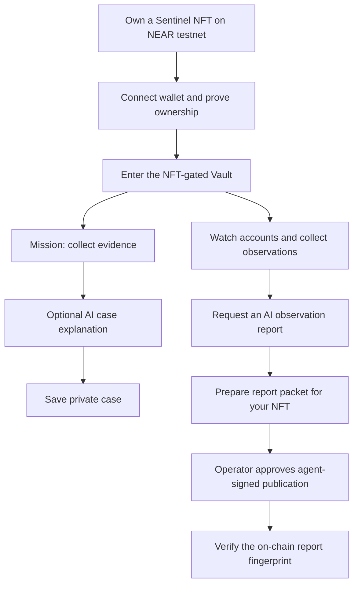

<a id="overview"></a>

# Sentinel Buddies

### Meet your buddy, unlock the intel

**Mint an NFT. Unlock an AI agent. Get access to NEAR intelligence, not guesswork.**

Sentinel Buddies turns an NFT into a key to a vault of NEAR research tools. Each minted buddy is linked to its own NEAR agent account, and **owning the NFT unlocks the Vault's gated tools**: an investigation desk, AI-assisted case files, personal account briefings, ecosystem liquidity insights and agent-economy intelligence.

> The NFT is your access key. The AI agent is your research companion. The Vault is where you put both to work.

[Explore the collection](https://sentinel-body.vercel.app/collection) · [Mint your buddy](https://sentinel-body.vercel.app/mint) · [Enter the Vault](https://sentinel-body.vercel.app/vault) · [Meet Arctic / NFT #1](https://sentinel-body.vercel.app/agent/1)

---

## A note on the name

**Previously named Sentinel Body.** Some URLs, package names and on-chain NFT titles retain the original name. Sentinel Buddies is the current product name; this is the same project, not a fork.

**Verify the current contract:** `sntl-02e90eacb8.testnet`. The retired `sentinel-body.testnet` and `sentinel-owner.testnet` accounts are **not** the current deployment. A familiar name alone is not proof that you have the right contract. See [naming history](#releases).

---

## What you get

| What you hold | What it unlocks | Why it matters |
|---|---|---|
| **Your Sentinel NFT** | Membership access to the Vault's holder-only tools | Ownership is the access credential, not simply connecting a wallet |
| **Your linked AI agent** | An investigation workspace tied to your buddy's NEAR agent identity | Give your buddy a mission, save your priorities, return to previous work |
| **Your intelligence Vault** | Account investigations, AI explanations, personal briefings, ecosystem and agent intelligence | Explore NEAR with sources, context and practical next checks in one place |


## How it works



**Two distinct workflows:** mission cases are saved privately. On-chain publication currently supports the separate watch-observation report workflow; mission exports are not publication packets.


1. **Mint** a Sentinel NFT on NEAR testnet, or receive an existing one. Each token has a linked NEAR agent account.
2. **Prove ownership.** Connect the wallet that owns the NFT and sign a challenge. Ownership is rechecked on every gated request.
3. **Choose a mission.** Investigate an account, unpack a transaction, review your watched accounts or request a NEAR ecosystem briefing.
4. **Put your buddy to work.** Collect evidence first, then explicitly request an AI explanation if you want one. Cases are saved privately for your next visit.

Public collection pages and evidence-checking endpoints let anyone inspect the project. They never expose a holder's private cases or preferences.

## Inside the Vault

| Tool | What it does |
|---|---|
| **Buddy Investigation Desk** | Turns a question into a saved case: account permissions, transaction execution, balance observations and recent activity, with an optional AI explanation that cites its sources |
| **Personal briefings** | Save the accounts you care about; "What changed for me?" compares recorded observations against your last reviewed briefing |
| **NEAR Ecosystem Liquidity Intelligence** | Block-pinned balance movements, DeFi TVL, DEX and broader trading volume and covered revenue in separate, labelled views |
| **Agentic Economy Intel** | Agent identities, balances, retained report publications and an interactive running-cost calculator |
| **Verifiable reports** | The separate watch-observation report workflow supports operator-approved publication of a fingerprint through the NFT’s linked agent |

Continue below: [Holder guide](#holder-guide) · [Intelligence tools](#intelligence-tools) · [Buddy missions](#holder-guide)

## What the evidence does and does not prove

The Vault shows five kinds of information. **Different evidence types support different conclusions.** The interface labels them separately.

| Kind | What you can verify | Does **not** establish |
|---|---|---|
| **Block-pinned chain reading** | The value returned by an RPC for a specified block, with source references for rereading | Why a value changed; that a decrease is a loss, sale or hack |
| **Third-party provider metric** (DefiLlama, NearBlocks) | What the provider reported at retrieval time | Completeness, or net capital flow |
| **Custom model or estimate** | A transparent calculation from stated inputs | An official score, a benchmark or a real charge |
| **AI interpretation** | The saved model response and its cited sources | That the interpretation is true. Source-ID checks reject unsupported reference IDs, not all hallucinations |
| **On-chain report fingerprint** | The committed hash and publishing agent; a matching report’s bytes can be checked if you possess the report and recompute its hash | That the AI's conclusions are correct |

Full limits, quotas and verification status: [Limitations](#limitations).

## Current status

A **working NEAR testnet prototype** with mainnet ecosystem observations.

- The AI runs **off-chain** through NEAR AI Cloud, only when a holder requests it and consents.
- Missions use bounded, read-only tools. Report publication needs explicit local operator approval.
- **Not autonomous.** No trading, no staking rewards and no investment returns are promised.

## Quickstart

**Verify the project without a wallet, credits or credentials** (Node 20.19+, internet access):

```bash
node scripts/check-submission-evidence.mjs
node scripts/check-chain-evidence.mjs
```

**Run the web app locally:**

```bash
corepack pnpm install --frozen-lockfile
corepack pnpm web          # then open http://localhost:3000/collection
```

Full setup, tests and hosted-backend configuration: [Development guide](#development).

## Choose your way in

| I want to... | Start here |
|---|---|
| Get a buddy | [Collection](https://sentinel-body.vercel.app/collection), then [Mint](https://sentinel-body.vercel.app/mint) |
| Use the Vault as a holder | [Vault](https://sentinel-body.vercel.app/vault) and the [Holder guide](#holder-guide) |
| Review or verify the project | [Verify the evidence](#verify) and the [Authenticity audit](#limitations) |
| Build on or inspect the code | [Development guide](#development) and [Architecture](#architecture) |
| Publish a report as operator | [Operator and judge guide](#operator-publication) |

## Read the complete guide

Everything below is included in this one README. These links move to sections on this page; no separate documentation files are needed.

- [Holder guide](#holder-guide)
- [Intelligence tools](#intelligence-tools)
- [Verify the evidence](#verify)
- [Architecture](#architecture)
- [Development guide](#development)
- [Limitations and verification status](#limitations)
- [Release history](#releases)

## Built with

NEAR accounts and function-call keys · NEP-171/177 NFTs · NEP-413 wallet authentication · Rust / near-sdk · NEAR AI Cloud · NEAR JSON-RPC · Next.js + Vercel · Cloudflare Worker + D1.

See [Architecture](#architecture) for why each was chosen.

## License

MIT. No investment returns, staking rewards or autonomous trading are promised.

---

<a id="holder-guide"></a>

## Holder guide

For people who own a Sentinel NFT. You need a **testnet wallet that currently owns a Sentinel NFT**. There is no universal demo login, and no organizer private key is supplied. If you only want to inspect the project, use [Verify the evidence](#verify) instead.


### 1. Enter the Vault

Connect your wallet, then prove ownership by signing a challenge. Connecting alone does not grant access, and ownership is rechecked on every NFT-gated request.

### 2. Investigate before you guess

Enter a NEAR account or transaction. The read-only investigator reports what the chain records and does not ask AI to invent a story.

- **Account checks:** native NEAR amount, locked balance, storage use, contract presence and access-key permissions at a finalized block. Full-access and function-call keys are distinguished. A public key does not identify its human owner.
- **Transaction checks:** supply the transaction hash and signer account to inspect finalized status, actions, attached deposits, execution outcomes and burnt fees. Execution accounts shown are not automatically money recipients.
- **Safety:** these checks never sign transactions, move funds or call the paid AI model. The interface shows up to 20 keys or actions. It is not a full token portfolio, a transaction-history index or a security verdict.

### 3. Buddy missions

Open your buddy's desk and pick a mission. Evidence collection and AI explanation are **two separate steps** with explicit consent between them.

| Action | Expected result |
|---|---|
| Open Vault, authenticate, enter your NFT ID, select **Open my buddy's desk** | Your linked agent identity, private priorities and case history load |
| Choose **Investigate an account**, **Unpack a transaction**, **What changed for me?** or **Brief me on NEAR** | A bounded read-only plan explains what evidence will be collected and its limits |
| Supply the required account/network or transaction hash/signer, optionally add a question, click **Collect evidence — no AI charge** | A case file with a tool log, readable recorded facts, evidence gaps and a source notebook. No model call, no transaction |
| Inspect the evidence, give consent, click **Ask my buddy to explain the evidence** once | **AI SYNTHESIS / COMPLETE**, a readout, source-linked findings, unresolved questions, next checks and provider-reported token usage. This step can incur an AI charge |
| Reopen the case from history | The saved explanation returns without another inference. Failed or pending attempts are kept and never retried automatically |
| For personal briefings, save watches in **My buddy priorities & memory**, collect a personal case, choose **Mark reviewed** | The next briefing compares newer saved observations with your reviewed baseline. Opening a case alone does not advance it |

**Reproduce the demonstrated transaction mission:** on NEAR testnet, use transaction hash `EPrjhgDpKxA6s2PZwm9QvuiacqtRXYx1uyshv9ahN1zL` and signer `agent-1.sntl-02e90eacb8.testnet`, and ask "What did my agent publish, did the transaction complete, and what does this transaction prove?" Recorded execution completed with one `publish_snapshot` action, zero attached NEAR and **0.0002771052331897 NEAR** burnt across returned outcomes. Investigating it sends no new transaction.

The owner's completed AI response for that case also overstated what could be concluded about recipients and broader history. Prompt instructions were later tightened, and the old result was kept rather than silently rewritten.

#### Memory and privacy

- Up to three existing watches, a priority and a reporting style are stored per holder and buddy.
- Personal briefings use **saved observations**, not continuous live scans or scheduled model calls.
- Account-permission comparisons need saved account missions. A preference does not enable background key monitoring.
- Cases and preferences are private to the creating holder and the selected NFT. **A new NFT owner does not inherit private history.**
- Case and model records remain after a watch is removed.
- **Case files are not publication packets.** Downloading case JSON or its checksum does not publish anything on-chain, and the report publisher does not accept mission exports.

### 4. Watch accounts, then ask your AI

Save accounts you care about, set a low-balance warning threshold and compare genuine observations. Code calculates balance changes before the model explains anything, and AI text is shown separately from recorded facts. With one observation there is no comparison and no invented second reading.

#### Watch-to-report walkthrough

1. **Save a valid mainnet or testnet account and threshold** under *My monitored accounts*. The collector targets a 15-minute interval. It is not an instant refresh. Existing watches may already have history.
2. **Inspect two recorded observations.** You see source RPC URLs, block hashes and heights, timestamps and the code-calculated change. Stale and error states are explicit.
3. **Explain my saved observations:** choose the watch, read the consent text and click **Explain saved evidence** once. NEAR AI provides an interpretation below the deterministic facts. Errors stay errors. A successful report can be reopened from AI execution history without another model call.
4. **Prepare a report packet:** open a completed report, enter an NFT ID you own, consent and choose **Prepare & download report packet**. This produces a private JSON packet and a prepared task. It sends no transaction and makes no new AI call.
5. **Operator publication:** the configured operator runs the local publisher's read-only preflight, then explicitly approves. The local process signs as that NFT's agent with its restricted key. This is not something every holder can do without operator and key provisioning.
6. **Click Check on-chain publication.** The result is `PUBLISHED · ON-CHAIN MATCH` only when the contract commitment matches agent, token and report hash. An unsubmitted packet, RPC failure or pruned commitment is never labelled a success.
7. **Explore the shared intelligence** below the holder tools. See [Intelligence tools](#intelligence-tools).

Publisher commands and access boundaries: [Operator publication](#operator-publication). Never commit private data, report packets or signing keys to Git.

<a id="operator-publication"></a>

### Operator publication — separate watch-report workflow

Do not run this to judge the existing transaction; use the public checker. New publication consumes testnet gas and changes the latest contract commitment.

1. In the authenticated Vault, open a completed report and prepare a packet for a token the holder owns.
2. Keep the packet outside Git. Review it: private evidence and holder-at-preparation are included.
3. From the original private working project, run the publisher with `--packet <path>` **without** `--approve-publish` → verify expected NFT, holder, agent, snapshot ID and hash. No key is read in this mode.
4. Only after explicit approval, add `--approve-publish` → one transaction uses `keys/testnet.json`'s fresh restricted worker key, signing as the selected agent. Do not move keys to the public hosting export or Cloudflare.
5. The script records the transaction hash before broadcasting, waits for final execution and checks the commitment at the execution block. A journal already exists or outcome is uncertain → stop and inspect it. Never delete the journal just to retry.
6. Refresh Vault history and retain the transaction link. No NFT is minted or transferred by this process.

The script requires `scripts/near-tx.mjs` relative to the working directory. A downloaded publisher may live elsewhere; the working directory determines the private keystore location. This intentionally avoids distributing operator credentials.

---

<a id="intelligence-tools"></a>

## Intelligence tools

The shared sections of the Vault. Everything here is public data or saved readings. None of it is output from a holder's AI run.

### 1. NEAR Ecosystem Liquidity Intelligence

**Where did the sampled balances move?** The tool prefers fresh block-pinned native NEAR comparisons, with an explicitly labelled archived fallback. It shows a full-width balance-change diagram, a category/account table, a plain-English takeaway and expandable explanations of what to check next.

| Category | Accounts sampled | What the reading covers |
|---|---|---|
| Intents / solver hub | `intents.near` | Native NEAR change in that hub account, not total swap volume or solver revenue |
| Liquid staking | `linear-protocol.near`, `meta-pool.near` | Selected contract balances, not all staking pools or all staked NEAR |
| DeFi venues | `v2.ref-finance.near`, `dclv2.ref-labs.near`, `contract.main.burrow.near` | Selected trading/lending contract accounts, not total deposits or volume |
| Bridge / Aurora | `aurora` | One selected account, not all bridge assets or flows |
| wNEAR reserve | `wrap.near` | The wrapped-NEAR contract's native balance, used as a reserve-account reading |

**How to read it**

- Later balance minus earlier balance equals the change. Green is an increase, rose/pink a decrease, and wider bands mean larger native-NEAR changes.
- Connecting bands group readings visually. **They are not traced transfers between projects.** Zero net change does not mean zero transactions.
- The headline totals the sample only when every selected account pair is available.
- The fresh method (AUD01) uses two pinned block hashes exactly 1,200 heights apart and shows the actual elapsed time. Its optional dollar figure uses a separately dated provider price, not a guaranteed block-time price.
- The archived fallback uses the original saved conversion and an intended window of roughly 12 hours. It is labelled historical and is not independently reread.
- A decrease is not automatically a loss, a sale, a hack or capital leaving NEAR.

### 2. Ecosystem Pulse: value held, traded and earned

A separate card retrieves public **DefiLlama** data through the frontend server's `/ecosystem-metrics` route. It is independent of the saved account comparison.

| Metric | Meaning | Boundary |
|---|---|---|
| Overall NEAR DeFi TVL | Dollar value locked in protocols covered by the provider's NEAR view | Not NEAR's market cap or every asset on the network |
| Tracked DEX volume, 24h | Sum of available 24-hour values for entries classified as `Dexs`, with reporting coverage shown | Excludes intents/bridge categories. Missing values are not counted as zero |
| Broader trading volume, 24h | The provider's broader trading total | Can include NEAR Intents, bridges and other categories, so it is not pure DEX volume |
| Covered revenue, 24h | The provider's NEAR revenue aggregate under its definitions | Not trader profit, NFT-holder income or every business's revenue |
| Liquidity direction | Daily TVL history, daily change and a prior-week comparison when available | A change in dollar value, **not measured net capital inflow or outflow** |

- The card also shows DEX 24-hour and 7-day breakdowns, broader trading and revenue entries, source links, retrieval time and chart dates.
- Protocol rows can overlap or use different cutoffs. Do not sum them to recreate aggregate totals.
- The 24-hour summary and the latest daily chart date may cover different periods.
- The route caches for up to five minutes. An unavailable source stays unavailable and is never replaced with invented figures. A new retrieval time does not guarantee a new provider observation.
- No net bridge flow or complete ecosystem transfer graph is claimed.

**Source endpoints**

- TVL: `https://api.llama.fi/v2/historicalChainTvl/Near`
- Trading: `https://api.llama.fi/overview/dexs/Near?excludeTotalDataChart=false&excludeTotalDataChartBreakdown=true`
- Revenue: `https://api.llama.fi/overview/fees/Near?excludeTotalDataChart=false&excludeTotalDataChartBreakdown=true&dataType=dailyRevenue`

Inspect the live JSON at [`/ecosystem-metrics`](https://sentinel-body.vercel.app/ecosystem-metrics). Check each source's `status`, `fetched_at`, source URL and record dates. A successful HTTP response can still contain an unavailable individual source.

### 3. Agentic Economy Intel

A separate section, not another name for ecosystem liquidity. The newer summary cards supplement the original detailed tools and do not replace them.

| Part | What you can inspect |
|---|---|
| Current direct-chain fleet evidence | Up to 20 minted NFTs, their agent mappings and native balances, up to 50 retained report commitments and the subset timestamped within 24 hours of the source block, all read at one finalized testnet block |
| Agent activity at a glance | Historical sampled-agent counts and the labelled custom model score |
| Saved running-budget example | A quick monthly estimate from a saved scenario. It stays fixed when you change calculator settings |
| Full historical health model | Original gauge and signal breakdowns, with completeness weights, missing-baseline defaults and duplicated proxies explained |
| Interactive running-cost calculator | Workload sliders, model selection, network fees, AI usage, hosting, storage, cost per 1,000 actions and cross-chain comparisons |
| Calculation details | Saved rates, inputs, formulas and available provenance |

**The health gauge is a custom weighted model.** It is not a security audit, an uptime guarantee, an official NEAR rating or a score for every AI agent on NEAR. Missing baselines previously produced neutral scores, and its confidence/coverage fields are developer-chosen weights, not statistical probabilities.

**Running costs are budget estimates, not charges.**

- Network fees, AI usage and hosting make up the monthly plan. NEAR reserved for storage is separate from a monthly subscription cost.
- Changing sliders never moves funds or triggers paid inference.
- Cross-chain comparisons include the same AI and hosting plan and exclude storage/rent reserves from recurring totals. They omit some execution-specific fees and do not establish a universal cheapest chain.

Official BigQuery and Intents documentation was reviewed, but neither is an active integration. BigQuery queries can cost money, and the Intents Explorer needs a partner JWT.

### Vocabulary

| Term | Meaning |
|---|---|
| **Agent account** | The NEAR account linked to a particular NFT. The AI model itself runs off-chain |
| **Snapshot / saved report** | Readings captured at a recorded point in time, not automatically current |
| **Cohort / sample** | A selected group of accounts, not the entire sector |
| **TVL** | Total value locked in the protocols the data provider includes |
| **Volume** | Value traded during a stated period, not value remaining in accounts |
| **Revenue** | The share counted as revenue under the source's methodology, not all fees or profit |
| **Commitment / fingerprint** | A hash recorded on-chain to identify a report's exact bytes |

---

<a id="verify"></a>

## Verify the evidence

The public checks in this section work **without a wallet, AI credits or credentials**. Requirements: Node **20.19 or newer**, internet access and a repository checkout.


### Fastest check

```bash
node scripts/check-submission-evidence.mjs
node scripts/check-chain-evidence.mjs
```

- **`check-submission-evidence.mjs`** checks the collection, the agent mapping, the restricted access key and the documented publication (signer and hash).
- **`check-chain-evidence.mjs`** fetches the deployed public chain-evidence packet and checks its checksum, pinned references, integer balance arithmetic and retained-publication counts.

Neither script signs transactions, reads private keys or calls AI. Both passed against the deployed endpoints during the latest documentation update. That is a point-in-time result, not a guarantee of continuous availability.

Optional extras:

```bash
# Download and verify the artwork image bytes
node scripts/check-submission-evidence.mjs --media

# Reread the sources behind a packet you saved from the fleet evidence card
node scripts/check-chain-evidence.mjs --packet ./sentinel-chain-evidence.json --reread

# Verify a report packet you deliberately hold (runs locally, uploads nothing)
node scripts/check-submission-evidence.mjs --packet ./buddy-report-3e62906f-f29a-472f-87d1-e5ef1da05b34.json
```

Old state may be pruned or rate-limited. The script reports unavailable rereads separately from matches and never treats missing data as verification. A matching checksum proves byte integrity, not independent attestation of an RPC provider or correctness of a model conclusion.

### No-wallet walkthrough (about 3 minutes)

| Step | Expected result |
|---|---|
| 1. Open [Collection](https://sentinel-body.vercel.app/collection) | Six registered artworks, minted/unminted labels, owners for existing NFTs, pause and availability status and a finalized block number. The count can change, so use the live reading |
| 2. Open [NFT #1](https://sentinel-body.vercel.app/agent/1) | Arctic artwork from NFT metadata and the linked account `agent-1.sntl-02e90eacb8.testnet` |
| 3. Open the [agent #1 transaction](https://testnet.nearblocks.io/txns/EPrjhgDpKxA6s2PZwm9QvuiacqtRXYx1uyshv9ahN1zL) | A successful transaction signed by **agent #1**, calling `publish_snapshot` on the NFT contract |
| 4. Run `node scripts/check-submission-evidence.mjs` | PASS checks for distinct artwork hashes, NFT #1 metadata and mapping, restricted agent permissions and the publication's signer/hash |
| 5. Open [Mint](https://sentinel-body.vercel.app/mint) without clicking mint | Remaining registered IDs, the next artwork and a live availability panel. Connecting a wallet alone does not mint |

**Expected seed state at the last verification:** 6 artwork entries. Existing IDs #0 Original and #1 Arctic. Next ID #2 Ember, minting unpaused. #3 Jade, #4 Royal and #5 Solar registered for subsequent IDs. Four IDs remained, and availability is not reserved for reviewers. Artwork can be appended, so six is not a lifetime cap.

**Public JSON endpoints:** [chain evidence](https://sentinel-body.vercel.app/chain-evidence) · [ecosystem provider metrics](https://sentinel-body.vercel.app/ecosystem-metrics). They hold public chain and provider data only, never private watches or AI case contents. Check each source's status and timestamp, not just HTTP 200.

### Public evidence you can check independently

| Item | Value |
|---|---|
| Settlement network | NEAR testnet |
| NFT contract | [`sntl-02e90eacb8.testnet`](https://testnet.nearblocks.io/address/sntl-02e90eacb8.testnet) |
| Report publisher | `agent-1.sntl-02e90eacb8.testnet` |
| NFT / owner at publication | `1` / `michaelomario.testnet` |
| Role | `holder-monitoring-report-publisher` |
| Report commitment ID | `buddy-report-3e62906f-f29a-472f-87d1-e5ef1da05b34` |
| Commitment block | `277652553` |
| Methodology | `holder-monitoring-ai-v1` |
| Transaction | `EPrjhgDpKxA6s2PZwm9QvuiacqtRXYx1uyshv9ahN1zL` |

Report SHA-256:

```text
fd14b92ed315ab1770a573b05aad87511e9dfba2859203a84a9d48907522c8df
```

The demonstrated report used observations at blocks **277650217** and **277648579**. Both recorded **6.8894279455544266 NEAR**. Code calculated **0 NEAR** net change across **960181575856 ns** (about 16 minutes). The AI correctly treated the cause as unknown, because unchanged balances do not establish the absence of transactions.

The private report body is **not public by default**. The public checker verifies the commitment and receipt, not the unseen body.

### Retired accounts

`sentinel-body.testnet` and `sentinel-owner.testnet` are **retired**. Their older exposed testnet credentials were replaced by the fresh deployment above. Never use them for verification.

---

<a id="architecture"></a>

## Architecture

### How evidence becomes intelligence

A balance dashboard shows a number. An AI answer may offer a plausible explanation without evidence. Neither alone tells a holder what was observed, what was calculated or who published the report. Sentinel Buddies separates those responsibilities:

1. **Observe:** a read-only Cloudflare Worker saves NEAR account amounts and exact block references in D1.
2. **Calculate:** code computes net balance change and elapsed block time using integer arithmetic.
3. **Explain:** NEAR AI Cloud receives a bounded evidence packet. Observation explanations use at most two saved readings. Mission cases can include account, transaction, watch or ecosystem sources. AI findings stay separate from recorded facts and calculated values.
4. **Attribute:** the holder prepares a report for a specific NFT they own. Its linked agent publishes the report's canonical SHA-256 hash through a restricted function-call key.
5. **Verify:** execution history checks the on-chain report hash, token ID and publishing agent. Hash agreement establishes byte consistency and attribution, **not AI correctness or the cause of a balance change**.

### System diagram

```text
Holder wallet ── NEP-413 / ownership check ──> Cloudflare Worker + D1
                                                  │
                      Cron ── NEAR RPC observations│
                      Holder consent ── NEAR AI ───┤
                                                  ▼
                                     Private report + task packet
                                                  │ download
                                                  ▼
                                   Local operator / restricted key
                                                  │ agent-signed publish_snapshot
                                                  ▼
                                      NEAR testnet NFT contract
                                                  │ read-only verification
                                                  ▼
                                           Vault task history
```

The agent's **defined responsibility is report publication**. Collection and inference are separate off-chain operations.

### Four kinds of evidence

The interface separates these source and calculation categories:

1. **Fresh block-pinned mainnet balance comparisons** and testnet fleet evidence
2. **An explicitly archived fallback** and the historical health model
3. **Third-party mainnet ecosystem aggregates** (DefiLlama)
4. **Cost scenarios** using saved rates

None of these is evidence that a holder's AI just executed. Private watches and AI execution history are kept separate from all of them. What each kind proves and does not prove is in the [README table](#what-the-evidence-does-and-does-not-prove) and [Limitations and verification status](#limitations).

### Trust boundaries

- The restricted worker key may be **shared across agent accounts**. This is not independent key custody per NFT.
- Holder and report authorization is enforced by the application and the local publisher, **not atomically by the publication contract**. Operator trust and ownership-change races therefore remain relevant.
- No agent private key is stored in the hosted Worker. The local publisher reads the restricted key from the operator's private keystore only after explicit approval.
- Administrators can append artwork and upgrade contract code.
- Model attestation is **not independently verified** by this app.
- The older Node runtime under `services/agent` is not the deployed Cloudflare runtime. Older milestone documents describe earlier states.

### Why NEAR, and what each technology does

| Technology | Role |
|---|---|
| **NEAR accounts and subaccounts** | Minting provisions `agent-<token_id>.<contract>` as a dedicated agent identity |
| **NEP-171 NFTs / NEP-177 metadata** | Ownership and registered artwork attach to token IDs, so artwork follows a transfer rather than a wallet |
| **NEAR function-call access keys** | The demonstrated agent has one key restricted to `publish_snapshot` on the NFT contract, with an allowance and no FullAccess permission |
| **Rust / near-sdk contracts** | Record NFT ownership, agent mappings and bounded report commitments. Publication requires a registered agent signer/predecessor |
| **NEP-413 wallet authentication** | Signed challenges establish holder sessions. The hosted receipt shortcut and organizer demo transaction routes are disabled |
| **NEAR AI Cloud** | The deployed text-analysis path uses `Qwen/Qwen3-VL-30B-A3B-Instruct` through an OpenAI-compatible API. Model attestation is not independently verified |
| **NEAR JSON-RPC** | Finalized account observations and read-only checks. The evidence sampler pins all selected amounts to common block hashes and retains raw responses |
| **NearBlocks indexer** | Up to five recent activity records for account missions. A limited lead source, not a complete ledger |
| **DefiLlama public APIs** | Third-party mainnet TVL, trading and revenue data via a separate Next.js server route. No private holder data or AI credentials are sent |
| **Next.js/React + Vercel; Cloudflare Worker/Cron + D1** | UI, private holder APIs, off-chain collection, AI orchestration and execution records |

### Where things run

| Question | Answer |
|---|---|
| Where do minting and report publication run? | NEAR **testnet** |
| Which networks can be investigated? | Mainnet and testnet |
| Which network do ecosystem metrics describe? | NEAR **mainnet** |
| Where does AI run? | Off-chain, through NEAR AI Cloud, when an authenticated holder requests it |
| What is recorded on-chain? | NFT ownership, agent mapping and explicitly published report commitments. Private report bodies are not published automatically |
| Is the agent autonomous? | No. Publication needs an operator's local restricted key and explicit approval |

---

<a id="development"></a>

## Development guide

### Repository layout

| Path | Contents |
|---|---|
| `contracts/sentinel-body/` | Rust NFT contract (provisioning, ownership, restricted keys, publication checks, artwork registry) |
| `hosting/cloudflare/` | Cloudflare Worker source, D1 schemas and deployable bundle |
| `apps/web/` | Next.js frontend and public evidence routes |
| `scripts/` | Verification and publisher scripts |
| `docs/` | Documentation |
| `services/agent/` | Older Node runtime. **Not** the deployed runtime |

### Prerequisites

- Node **20.19 or newer** and Corepack
- Internet access (dependency downloads and Next font fetching)
- For contract work: Rust with the `wasm32-unknown-unknown` target

### Install, test and build the web app

From the repository root (the same commands work in bash, zsh and PowerShell):

```bash
corepack pnpm install --frozen-lockfile
corepack pnpm test:transactions
corepack pnpm test
corepack pnpm typecheck:web
corepack pnpm build:web
```

Use the package-manager version pinned in `package.json`. These commands do not deploy, mint or call the paid model. A passing unit test is not proof of live wallet, model or network execution.

### Run locally

```bash
corepack pnpm web
```

Open `http://localhost:3000/collection`. The frontend's `/collection-state` route reads public testnet state. Other gateway-backed pages need a separately configured gateway, and the default local target is `http://127.0.0.1:8787`. This command alone does not reproduce full authenticated Cloudflare behaviour. Do not loosen production CORS to accommodate an unreviewed local origin.

### Hosted backend configuration

Source: `hosting/cloudflare/worker-source.ts`. Deployable bundle: `hosting/cloudflare/worker.mjs`.

A separate deployment needs its own Worker, D1 database and binding, exact allowed frontend origin and secrets. Apply the additive schemas **in order**: `schema.sql`, `schema-watchlist.sql`, `schema-ai.sql`, `schema-agent-reports.sql`, `schema-missions.sql`. Preserve existing tables when upgrading. `wrangler.jsonc` holds template values and is **not a turnkey production configuration**.

| Binding / setting | Purpose |
|---|---|
| `DB` | D1 binding |
| `ALLOWED_ORIGIN` | Exact frontend origin, no trailing slash |
| `JWT_SECRET` (secret) | Holder-session signing |
| `MONITOR_ENABLED=1` | Enable scheduled observation collection |
| Cron `* * * * *` | Check due work each minute. Target observation interval is 15 minutes |
| `NEAR_AI_API_KEY` (secret) | NEAR AI Cloud inference credential. Never a public frontend variable |
| `AI_ENABLED=1` | Opt in to model calls. Set `0` to stop new AI calls |

Mission tables are `buddy_profiles` and `buddy_cases`. Model attempts reuse `ai_reports` so quotas are shared. QUOTA01 and AUD01 need no further SQL migrations. Keep quota and audit history intact. Public `/chain-evidence` and `/ecosystem-metrics` routes run in Next.js, separately from the holder-gated Worker APIs.

No agent private key is stored in the hosted Worker. The local publisher reads the restricted key from the operator's private keystore only after explicit approval.

> ⚠️ **Never run `scripts/deploy.mjs` to inspect or upgrade the live demo.** It is an initial deployment and initialization workflow.

### Contract tests

With compatible Rust dependencies and the wasm target installed:

```bash
cargo test --locked --workspace --lib
cargo build --locked --target wasm32-unknown-unknown --release -p sentinel-body
```

`--offline` can be added when dependencies are cached. The build embeds `contracts/sentinel-body/res/agent_account.wasm`. Preserve the controller artifact and follow the documented build process for a fresh deployment. Do not substitute a rebuild into the live contract without a state-preservation review.

Fifteen NFT-contract unit tests and the metadata-upgrade build passed on the operator's Windows setup. A fresh contract-sandbox end-to-end run is not claimed.

### Source map

| Path | Inspect for |
|---|---|
| `contracts/sentinel-body/src/lib.rs` | Provisioning, ownership, restricted keys and publication checks |
| `contracts/sentinel-body/src/artwork.rs` | Append-only artwork registry, existing-token assignment, mint coverage |
| `hosting/cloudflare/platform.ts` | Holder authentication and on-chain access checks |
| `hosting/cloudflare/investigate.ts` | Read-only account/transaction checks and exact arithmetic |
| `hosting/cloudflare/watchlist.ts` | Collector, exact arithmetic, source provenance and warning status |
| `hosting/cloudflare/ai-analysis.ts` | Model prompt, consent, quotas, cache and output/reference validation |
| `hosting/cloudflare/ai-quota.ts` | Specific quota/cooldown diagnosis after atomic reservation rejection |
| `hosting/cloudflare/missions.ts`, `schema-missions.sql` | Mission plans, private preferences/cases, review baselines and bounded AI synthesis |
| `hosting/cloudflare/agent-reports.ts` | Token-specific task authorization, packet hash and publication history |
| `scripts/publish-agent-report.mjs` | Read-only preflight, explicit signing approval and final receipt checks |
| `scripts/check-submission-evidence.mjs` | Public verification without secrets |
| `scripts/check-chain-evidence.mjs` | Public packet validation and optional historical RPC rereads |
| `apps/web/app/chain-evidence/route.ts`, `apps/web/lib/chain-evidence.ts` | Block-pinned sampler, exact native deltas, fleet reads, raw evidence and caching |
| `apps/web/app/collection-state/route.ts` | Finalized collection-state read |
| `apps/web/app/ecosystem-metrics/route.ts` | Public provider fetches, per-source failure states and caching |
| `apps/web/lib/ecosystem-data.ts` | Provider validation, missing-value handling and DEX-only classification |
| `apps/web/components/account-investigator.tsx` | Guided investigation and Vault introduction |
| `apps/web/components/buddy-missions.tsx` | Mission desk, consent, source notebook, case history and private exports |
| `apps/web/components/evidence-panel.tsx` | Evidence classes, official reference links and direct-fleet evidence |
| `apps/web/components/liquidity-map.tsx` | Expanded balance map, sampled accounts and explanations |
| `apps/web/components/ecosystem-pulse.tsx` | TVL, trading/revenue cards, history and source details |
| `apps/web/components/agent-economy-summary.tsx`, `indices.tsx` | Summaries plus the original health/cost components |
| `apps/web/components/dashboard.tsx` | Separate ecosystem and agentic-economy sections |
| `apps/web/components/ai-explanation.tsx`, `agent-report.tsx` | Facts/AI separation and task-history UI |
| Evidence and limitations section | Audit findings, corrections, independent checks and limits |
| Holder guide section | Mission operation, privacy, tool coverage and deployment details |

---

<a id="limitations"></a>

## Limitations and verification status

This section records what has and has not been demonstrated. These limits are part of the evidence, not fine print. For what each kind of evidence proves, see the [README table](#what-the-evidence-does-and-does-not-prove).

### Verification status

| Capability | Status |
|---|---|
| Six distinct registered artworks; #0/#1 metadata upgrade without remint | Demonstrated. Owners and agent records were preserved during the upgrade |
| Live collection, mint availability, token-specific agent artwork | Deployed. Live collection confirmed, but individual screens may be affected by RPC or image availability |
| Private holder watchlists and repeated observations | Demonstrated in production. Two blocks shown in the AI report |
| Exact balance comparison | Demonstrated. Zero change across about 16 minutes |
| Original observation AI inference | Demonstrated. The provider reported 1,021 total input/output tokens for the original watch-report response. This is not the token count of the newer mission example |
| Mission AI transaction readout | Owner demonstrated a completed production response with source-linked findings after QUOTA01. Interpretation still requires review |
| Personal priorities, review baseline and ecosystem missions | Implemented. Mocked backend/privacy tests and live public-source collection passed. A complete production AI demonstration of each is **not** claimed |
| Block-pinned evidence service | Deployed endpoint returned available liquidity/fleet sources. Public checksum/arithmetic/count checker passed. Historical source rereads passed during development |
| Agent #1 publication and on-chain task-history match | Demonstrated with the linked transaction and independently checked |
| Read-only account/transaction investigation | Implemented. Live read-only and mocked backend checks passed |
| Expanded liquidity and agentic-economy UI | Deployed. Owner reviewed the updated presentation |
| Ecosystem TVL, trading and revenue integration | Deployed. Endpoint returned all three sources as available during the latest check. External availability and coverage can change |
| Low-balance warning | Implemented and local mock-tested. Production threshold-crossing test **not** demonstrated |
| New mint after the artwork upgrade | **Not separately verified.** Do not claim a post-upgrade mint test passed |
| Transfer after the upgrade | **Not separately demonstrated.** Do not claim end-to-end transfer testing |
| Autonomous per-NFT execution | **Not implemented.** Publication is operator-triggered |
| Independent AI attestation / truth verification | **Not implemented** |

### Operational limits

**AI usage**

- AI is holder-triggered, with consent and bounded input.
- Maximum output is 700 tokens for observation explanations and 1,200 for mission explanations.
- Results are cached and there are no automatic retries.
- Quotas: one new attempt per minute and ten per day per holder, ten per day globally and forty total demo attempts. **Failed attempts count.**
- These are application request limits, not a dollar cap on other uses of the API key.
- Credits, RPC availability and free-tier CPU limits can interrupt service.

**Watches**

- Three watches per holder and thirty globally.
- The collector handles at most three due watches per tick.

**Missions**

- Four mission write/collection operations per minute and one new case per 30 seconds.
- 30 cases per holder and 120 globally. Failed or interrupted collections remain counted.
- Up to 30 cases per buddy are listed.
- Personal collection reads up to two saved observations per selected watch.
- Evidence is capped at 20,000 characters per case.
- No scheduled AI mission and no automatic retry exists.

### Known limits of the evidence

- Model source-ID validation prevents fabricated reference IDs, **not all hallucinations**. Explanations remain unverified hypotheses.
- NearBlocks provides at most five recent activity records. They are not a complete ledger or proof of why a balance dropped.
- Saved reports can be stale.
- Private observations and AI reports are not automatically on-chain. Only explicitly published report packets receive commitments.
- D1 audit and quota records remain after a watch is removed, although they are hidden from the watch-linked UI.
- Snapshot history keeps only the newest configured entries (currently 50). Transaction receipts remain separate evidence when a commitment is pruned.
- Artwork uses content-hashed Vercel URLs. Hashes detect byte changes but do not guarantee permanent hosting.
- Administrators can append artwork and upgrade contract code.
- The old snapshot's hash was checked against the live contract and matches. That proves integrity, not every original source value.

### Naming

The product is **Sentinel Buddies**. Deployed metadata titles may still say **Sentinel Body**, and the repository, package and domain names keep their original identifiers, because the project was renamed **after** the contracts were deployed. See the notice at the top of the [product overview](#overview). The retired `sentinel-body.testnet` and `sentinel-owner.testnet` accounts must never be used.

---

<a id="releases"></a>

## Release history

Release codes (UX01, MIS01 and so on) appear in older notes, code comments and some docs. This page explains what each one means.

| Code | Name | What it added | Verification status |
|---|---|---|---|
| **UX01** | Guided investigation | Guided account/transaction investigation and clearer positioning of the NFT-linked AI agent | Live read-only checks and backend regression tests passed |
| **ECO01** (revised) | Ecosystem and agentic-economy sections | Separate liquidity and agentic-economy sections, expanded account map, provider TVL/trading/revenue data. Original health and cost tools retained | Owner reviewed the deployed interface. The ecosystem endpoint returned all three provider sources as available during the latest check |
| **MIS01** | Buddy missions | The Buddy Investigation Desk: evidence collection, AI case explanations, saved priorities, personal briefings and ecosystem briefings | Owner demonstrated a completed transaction mission and a real NEAR AI readout in production. Other mission types have local/mock coverage and live public-source checks. A production AI run for every type is not claimed |
| **QUOTA01** | Quota fix | Holder allowance raised to ten attempts per day. Specific quota and cooldown errors shown beside the AI button | Deployed. The owner's previously blocked mission completed after the fix. Global daily and lifetime caps were not increased or reset |
| **AUD01** | Authenticity audit | Exact block-pinned liquidity evidence, current fleet evidence, downloadable raw responses, honest model labels and corrected budget comparisons | Deployed public endpoint returned available liquidity/fleet data and `check-chain-evidence.mjs` passed. During development, 24 pinned RPC responses also matched a later reread |
| **AG01** | Agent report publication | The watch-report workflow: a report packet is hashed and published on-chain by the NFT's linked agent. It accepts watch-observation reports only, not mission cases | Demonstrated with agent #1's linked transaction and independently checked |

These checks do not certify every AI sentence, every upstream aggregate or every application path. See [Limitations and verification status](#limitations).

### Naming history

The project began as **Sentinel Body** and was renamed **Sentinel Buddies** *after* its smart contracts were deployed. The new name applies to the website and product. Deployed identifiers, on-chain metadata titles, the repository, package names and the domain were deliberately left as they were. Older exposed testnet credentials were replaced by a fresh deployment, and the old `sentinel-body.testnet` and `sentinel-owner.testnet` accounts are retired. Older milestone documents describe earlier states, and the README and [Operator publication](#operator-publication) describe the current deployment.
