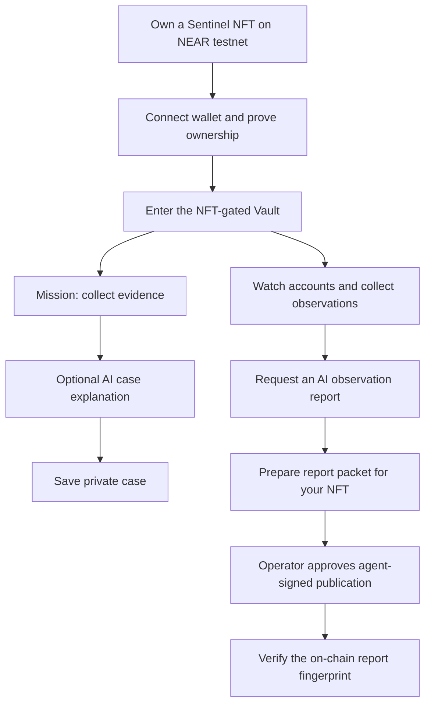

# Sentinel Buddies

### Meet your buddy, unlock the intel

**Mint an NFT. Unlock an AI agent. Get access to NEAR intelligence, not guesswork.**

Sentinel Buddies turns an NFT into a key to a vault of NEAR research tools. Each minted buddy is linked to its own NEAR agent account, and **owning the NFT unlocks the Vault's gated tools**: an investigation desk, AI-assisted case files, personal account briefings, ecosystem liquidity insights and agent-economy intelligence.

> The NFT is your access key. The AI agent is your research companion. The Vault is where you put both to work.

[Explore the collection](https://sentinel-body.vercel.app/collection) · [Mint your buddy](https://sentinel-body.vercel.app/mint) · [Enter the Vault](https://sentinel-body.vercel.app/vault) · [Meet Arctic / NFT #1](https://sentinel-body.vercel.app/agent/1)

---

## A note on the name

**Previously named Sentinel Body.** Some URLs, package names and on-chain NFT titles retain the original name. Sentinel Buddies is the current product name; this is the same project, not a fork.

**Verify the current contract:** `sntl-02e90eacb8.testnet`. The retired `sentinel-body.testnet` and `sentinel-owner.testnet` accounts are **not** the current deployment. A familiar name alone is not proof that you have the right contract. See [naming history](docs/RELEASES.md#naming-history).

---

## What you get

| What you hold | What it unlocks | Why it matters |
|---|---|---|
| **Your Sentinel NFT** | Membership access to the Vault's holder-only tools | Ownership is the access credential, not simply connecting a wallet |
| **Your linked AI agent** | An investigation workspace tied to your buddy's NEAR agent identity | Give your buddy a mission, save your priorities, return to previous work |
| **Your intelligence Vault** | Account investigations, AI explanations, personal briefings, ecosystem and agent intelligence | Explore NEAR with sources, context and practical next checks in one place |


## How it works



**Two distinct workflows:** mission cases are saved privately. On-chain publication currently supports the separate watch-observation report workflow; mission exports are not publication packets.


1. **Mint** a Sentinel NFT on NEAR testnet, or receive an existing one. Each token has a linked NEAR agent account.
2. **Prove ownership.** Connect the wallet that owns the NFT and sign a challenge. Ownership is rechecked on every gated request.
3. **Choose a mission.** Investigate an account, unpack a transaction, review your watched accounts or request a NEAR ecosystem briefing.
4. **Put your buddy to work.** Collect evidence first, then explicitly request an AI explanation if you want one. Cases are saved privately for your next visit.

Public collection pages and evidence-checking endpoints let anyone inspect the project. They never expose a holder's private cases or preferences.

## Inside the Vault

| Tool | What it does |
|---|---|
| **Buddy Investigation Desk** | Turns a question into a saved case: account permissions, transaction execution, balance observations and recent activity, with an optional AI explanation that cites its sources |
| **Personal briefings** | Save the accounts you care about; "What changed for me?" compares recorded observations against your last reviewed briefing |
| **NEAR Ecosystem Liquidity Intelligence** | Block-pinned balance movements, DeFi TVL, DEX and broader trading volume and covered revenue in separate, labelled views |
| **Agentic Economy Intel** | Agent identities, balances, retained report publications and an interactive running-cost calculator |
| **Verifiable reports** | The separate watch-observation report workflow supports operator-approved publication of a fingerprint through the NFT’s linked agent |

Details: [Holder guide](docs/HOLDER-GUIDE.md) · [Intelligence tools](docs/INTELLIGENCE-TOOLS.md) · [Buddy missions](docs/BUDDY-MISSIONS.md)

## What the evidence does and does not prove

The Vault shows five kinds of information. **Different evidence types support different conclusions.** The interface labels them separately.

| Kind | What you can verify | Does **not** establish |
|---|---|---|
| **Block-pinned chain reading** | The value returned by an RPC for a specified block, with source references for rereading | Why a value changed; that a decrease is a loss, sale or hack |
| **Third-party provider metric** (DefiLlama, NearBlocks) | What the provider reported at retrieval time | Completeness, or net capital flow |
| **Custom model or estimate** | A transparent calculation from stated inputs | An official score, a benchmark or a real charge |
| **AI interpretation** | The saved model response and its cited sources | That the interpretation is true. Source-ID checks reject unsupported reference IDs, not all hallucinations |
| **On-chain report fingerprint** | The committed hash and publishing agent; a matching report’s bytes can be checked if you possess the report and recompute its hash | That the AI's conclusions are correct |

Full limits, quotas and verification status: [Limitations](docs/LIMITATIONS.md).

## Current status

A **working NEAR testnet prototype** with mainnet ecosystem observations.

- The AI runs **off-chain** through NEAR AI Cloud, only when a holder requests it and consents.
- Missions use bounded, read-only tools. Report publication needs explicit local operator approval.
- **Not autonomous.** No trading, no staking rewards and no investment returns are promised.

## Quickstart

**Verify the project without a wallet, credits or credentials** (Node 20.19+, internet access):

```bash
node scripts/check-submission-evidence.mjs
node scripts/check-chain-evidence.mjs
```

**Run the web app locally:**

```bash
corepack pnpm install --frozen-lockfile
corepack pnpm web          # then open http://localhost:3000/collection
```

Full setup, tests and hosted-backend configuration: [Development guide](docs/DEVELOPMENT.md).

## Choose your way in

| I want to... | Start here |
|---|---|
| Get a buddy | [Collection](https://sentinel-body.vercel.app/collection), then [Mint](https://sentinel-body.vercel.app/mint) |
| Use the Vault as a holder | [Vault](https://sentinel-body.vercel.app/vault) and the [Holder guide](docs/HOLDER-GUIDE.md) |
| Review or verify the project | [Verify the evidence](docs/VERIFY.md) and the [Authenticity audit](docs/AUTHENTICITY-AUDIT.md) |
| Build on or inspect the code | [Development guide](docs/DEVELOPMENT.md) and [Architecture](docs/ARCHITECTURE.md) |
| Publish a report as operator | [Operator and judge guide](docs/JUDGE-GUIDE.md) |

## Documentation

| Document | Contents |
|---|---|
| [HOLDER-GUIDE.md](docs/HOLDER-GUIDE.md) | Missions, investigations, watchlists, report publication, privacy |
| [INTELLIGENCE-TOOLS.md](docs/INTELLIGENCE-TOOLS.md) | Liquidity map, Ecosystem Pulse, Agentic Economy Intel, vocabulary |
| [VERIFY.md](docs/VERIFY.md) | No-wallet walkthrough, public evidence, verification scripts |
| [ARCHITECTURE.md](docs/ARCHITECTURE.md) | Evidence pipeline, technology choices, trust boundaries |
| [DEVELOPMENT.md](docs/DEVELOPMENT.md) | Setup, tests, backend configuration, source map |
| [LIMITATIONS.md](docs/LIMITATIONS.md) | Verification status table, quotas, known limits |
| [RELEASES.md](docs/RELEASES.md) | Release history and what each release code (UX01, MIS01, ...) means |
| [BUDDY-MISSIONS.md](docs/BUDDY-MISSIONS.md) | Mission operation, privacy, tool coverage |
| [AUTHENTICITY-AUDIT.md](docs/AUTHENTICITY-AUDIT.md) | Audit findings, corrections, independent checks |
| [JUDGE-GUIDE.md](docs/JUDGE-GUIDE.md) | Shortest review path, failure handling, publisher commands |

## Built with

NEAR accounts and function-call keys · NEP-171/177 NFTs · NEP-413 wallet authentication · Rust / near-sdk · NEAR AI Cloud · NEAR JSON-RPC · Next.js + Vercel · Cloudflare Worker + D1.

See [Architecture](docs/ARCHITECTURE.md) for why each was chosen.

## License

MIT. No investment returns, staking rewards or autonomous trading are promised.
